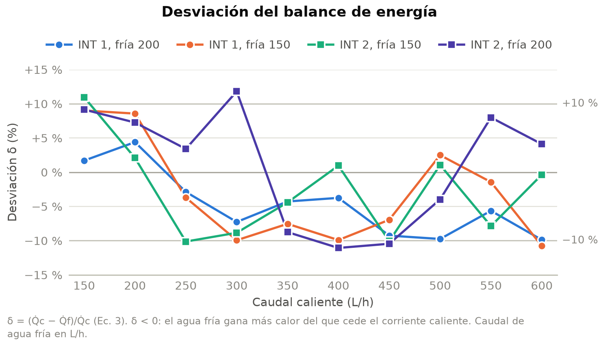
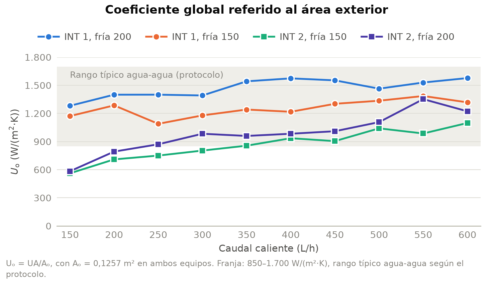
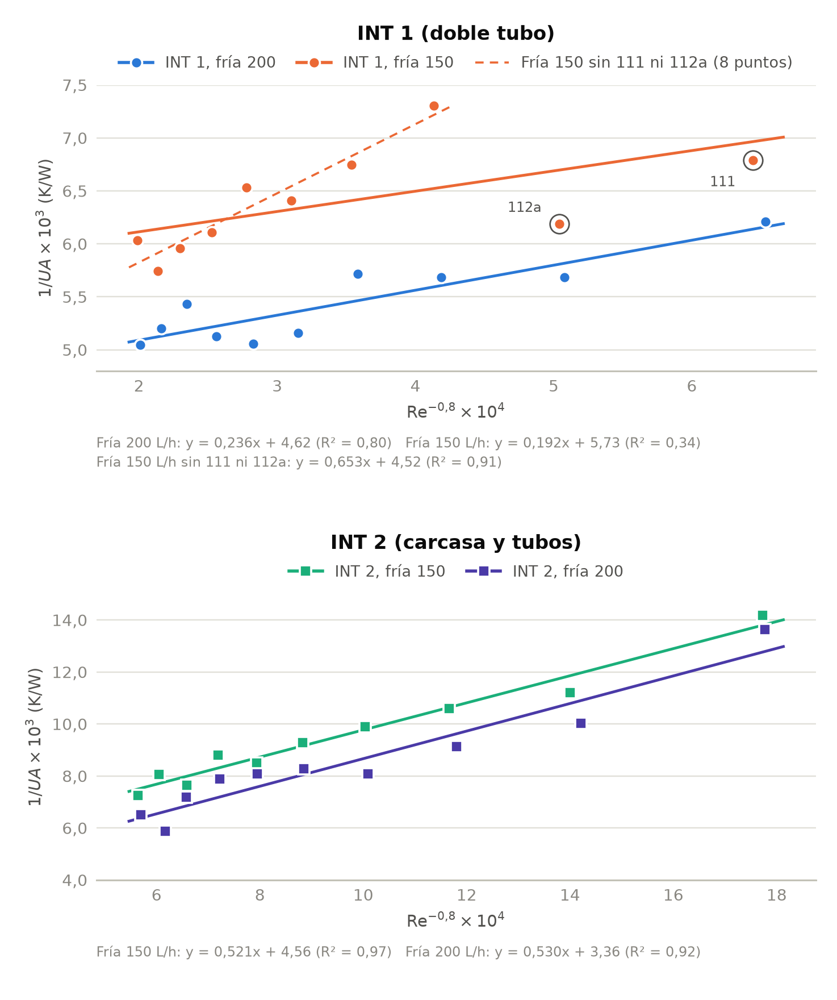
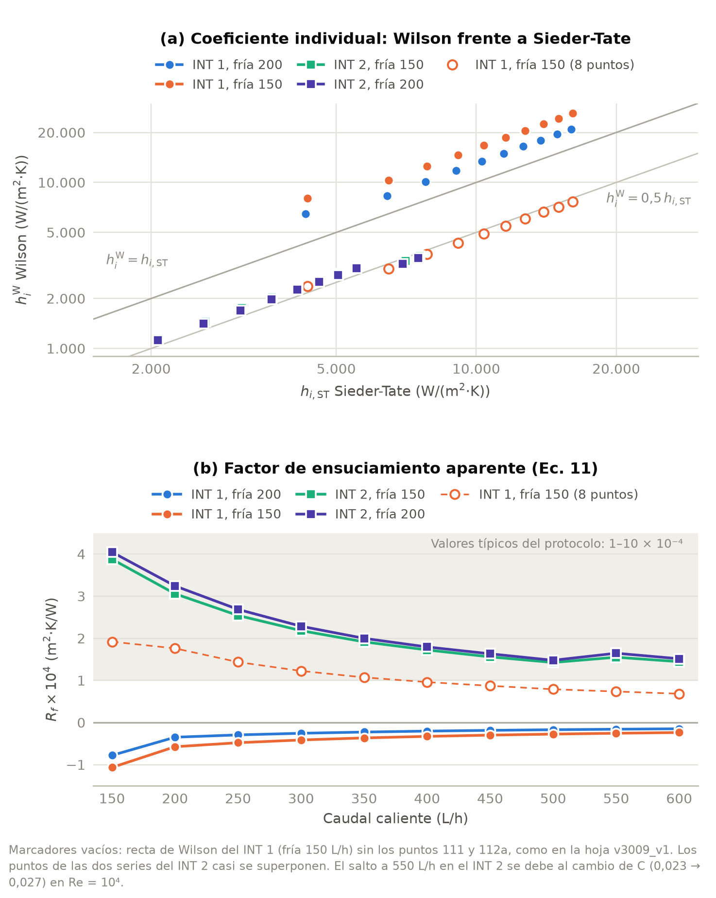
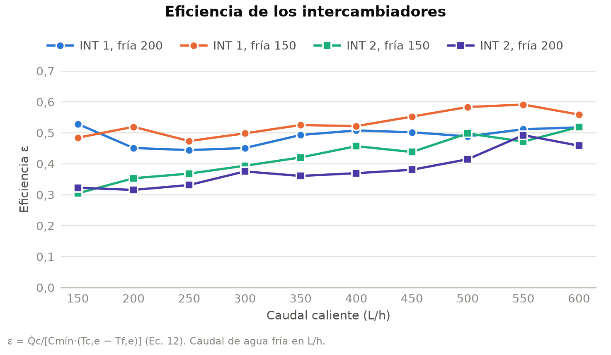

# Informe BC: intercambiadores de calor. Resultados y discusión

30 de septiembre de 2026 · Datos: v3009_v1.xlsx · Versión en castellano de la sección 3 del borrador

## Notas para el equipo (borrar antes de entregar)

Este texto sustituye a la sección 3 del borrador. Usa los valores de la hoja v3009_v1.xlsx con una excepción: la recta de Wilson del INT 1 con agua fría a 150 L/h se calcula con los diez puntos (filas 14–23), como indicaba el borrador. Los valores entre corchetes [ ] se deben completar o confirmar.

**Cambios necesarios en la hoja para que coincida con el texto**

- «INT 1», celdas AC16:AC18 (pendiente, ordenada y R²): usar las filas 14–23 en lugar de 16–23. Con ello cambian C1 (AC20), hiW (AA14:AA23) y Rf (AL14:AL23).
- «Rf vs Caudal caliente»: los valores están pegados, no enlazados. Hay que actualizar a mano E16:E25 (INT 1 con agua fría a 150 L/h).
- «INT 2», celda AL2, y «Rf vs Caudal caliente», celda H3: la unidad de Rf es m²·K/W, no W/(m²·K).

**Cálculos del texto que no están en la hoja.** Si se mantienen en el informe, conviene reproducirlos en el Excel. El script analisis_BC.py los calcula todos.

- Error típico de las pendientes de Wilson e intervalo de confianza del 95 %.
- Rectas de Wilson con UA calculado con la media de Q̇c y Q̇f (prueba de sensibilidad).
- Coeficiente exterior equivalente, ho ≈ 1/(C2·Ao), y peso de la película interior en la resistencia total, (1/C1)·Re−0,8/(1/UA).
- Re del espacio anular del INT 1 (Dh = 10 mm; viscosidad del agua con una correlación de tipo Vogel, μ = 2,414·10−5·10247,8/(T − 140) Pa·s).
- Corrección de ΔTc necesaria para cerrar el balance, NTU y Cr, y la estimación de (μ/μw)0,14.

**Pendiente de confirmar**

- Precisión de las sondas de temperatura.
- Criterio de repetición (10 % u 11 %). Tras las repeticiones quedan siete puntos con |δ| > 10 % y dos con |δ| > 11 % (INT 2 con agua fría a 200 L/h, a 300 y 400 L/h).
- Número de pasos por tubos del INT 2 (se supone un solo paso con los cinco tubos en paralelo) y si la carcasa tiene deflectores.
- Si los rotámetros están calibrados para agua.
- Qué Q̇ usar para calcular UA (Q̇c, Q̇f o la media): consultar con el profesor.
- Referencias de las correlaciones de conductividad de la hoja EC1 (Ramires et al., 1995, para el agua; «Deng y Zhang» para el etilenglicol): hay que añadir los datos completos a la bibliografía. No he podido verificar la segunda.

**Figuras y numeración.** Las figuras se han rehecho en castellano con los mismos colores que el borrador, salvo la serie INT 2 con agua fría a 200 L/h, que pasa de azul marino a violeta para distinguirla mejor. Se mantiene la numeración del borrador (Ec. 1–14, y Tabla 1 y Figura 1 en la sección 2). La nueva Figura 5 (hi y Rf) hace que la de eficiencia pase a ser la Figura 6. La sección 4 (Conclusiones) debe actualizarse con los resultados de Rf.

## 3. Resultados y discusión

Los balances de energía cierran dentro de ±12 % y los coeficientes globales están, en su mayoría, en el rango típico de un intercambiador agua-agua. El método de Wilson da resultados coherentes en el INT 2, pero no en el INT 1, por un motivo físico que se explica en el apartado 3.3. En consecuencia, el factor de ensuciamiento solo puede estimarse en el INT 2, y aun así debe interpretarse como un valor aparente (apartado 3.4).

### 3.1 Balance de energía

La desviación del balance (Ec. 3) se mantiene entre −11,1 % y +11,8 % en los 40 puntos (Figura 2). La media de cada serie va de −4,7 % (INT 1, agua fría a 200 L/h) a +1,0 % (INT 2, agua fría a 200 L/h), con desviaciones típicas de 5 a 9 puntos porcentuales.

*Figura 2. Desviación del balance de energía (Ec. 3) en función del caudal caliente.*

La desviación no es aleatoria, sino que depende del caudal caliente. A 150 y 200 L/h es positiva en los ocho puntos (Q̇c > Q̇f), lo que es coherente con pérdidas de calor al ambiente. A partir de 250 L/h predominan las desviaciones negativas (25 de 32 puntos): el agua fría gana más calor del que cede el corriente caliente, algo que las pérdidas no pueden explicar.

La causa más probable es la medida de ΔTc. Al aumentar el caudal caliente, el salto térmico de este corriente baja hasta 3,8–5,5 K a 550–600 L/h, mientras que el del agua fría se mantiene en 12–17 K. Por eso, un mismo error absoluto de temperatura pesa entre 2,4 y 4,2 veces más en Q̇c que en Q̇f. En los 25 puntos con δ < 0, bastaría con que ΔTc fuera entre 0,01 y 0,75 K mayor que el medido para cerrar el balance [comparar con la precisión de las sondas]. El cambio de signo se explicaría por la combinación de dos efectos: unas pérdidas aproximadamente constantes, que pesan más a caudal bajo, y un pequeño error sistemático en ΔTc (por ejemplo, una diferencia de calibración entre las sondas de entrada y salida del corriente caliente), que pesa más cuanto menor es ΔTc.

Los puntos que superaban el criterio de repetición [10 %] se repitieron, y en el análisis se usan las repeticiones. En el INT 1, las repeticiones difieren de los puntos originales entre 3 y 22 puntos porcentuales en δ (el mayor cambio, en el punto 120: de −32,8 % a −10,8 %), lo que sugiere que algunos puntos originales se tomaron antes de alcanzar el estado estacionario.

Como UA se calcula con Q̇c, esta tendencia se propaga a los resultados siguientes: donde δ ≈ −10 %, el UA calculado con Q̇f sería un 10 % mayor. Su efecto sobre el método de Wilson se analiza en el apartado 3.3.

### 3.2 Coeficiente global

El coeficiente global referido al área exterior (Uo = UA/Ao) aumenta con el caudal caliente en las cuatro series (Figura 3). En el INT 1 va de 1.090 a 1.580 W/(m²·K), dentro del rango típico agua-agua que da el protocolo (850–1.700 W/(m²·K)). En el INT 2 va de 560 a 1.350 W/(m²·K), y los puntos con caudal caliente bajo (hasta 200–300 L/h) quedan por debajo de ese rango.

*Figura 3. Coeficiente global Uo en función del caudal caliente para cada serie.*

Como los dos equipos tienen la misma área exterior (0,1257 m²), la diferencia se debe a los coeficientes individuales. La respuesta de Uo a cada caudal indica qué película controla la transmisión de calor en cada equipo:

- En el INT 1, cuadruplicar el caudal caliente (de 150 a 600 L/h) solo aumenta Uo un 13–23 %, mientras que pasar el agua fría de 150 a 200 L/h (+33 %) lo aumenta un 18 % de media. La resistencia dominante es la del lado del agua fría.
- En el INT 2, el mismo aumento del caudal caliente duplica Uo (×2,0–2,1), y el aumento del caudal frío lo eleva un 14 % de media. Aquí la película interior tiene un peso mucho mayor.

Esto es coherente con las condiciones de flujo. Dentro de los tubos del INT 2 la mezcla circula a 0,29–1,18 m/s (Re = 2.700–11.500), unas 2,8 veces más despacio que en el tubo del INT 1 (0,83–3,32 m/s; Re = 9.600–42.400), porque el mismo caudal se reparte entre cinco tubos. En el espacio anular del INT 1, en cambio, el agua fría circula a solo 0,18–0,24 m/s, con Re ≈ 2.100–2.900 (estimado con el diámetro hidráulico, 10 mm, y la viscosidad del agua a su temperatura media), es decir, en régimen laminar o de transición. Esa película exterior es la que limita el coeficiente global del INT 1.

Las irregularidades de algunas curvas, como el mínimo del INT 1 a 250 L/h con agua fría a 150 L/h o el máximo del INT 2 a 550 L/h con agua fría a 200 L/h, son del orden de la dispersión del balance y no deben interpretarse como efectos físicos.

### 3.3 Método de Wilson

La representación de 1/UA frente a Re−0,8 se ajusta a una recta para cada serie (Figura 4). La Tabla 2 recoge los parámetros de los ajustes, que incluyen los diez puntos de cada serie. La fila en cursiva es la prueba de sensibilidad que se comenta más abajo.

*Figura 4. Rectas de Wilson (Ec. 8) del INT 1 y el INT 2 para los dos caudales de agua fría. Las ecuaciones están en las unidades escaladas de los ejes. En el INT 1 se marcan los puntos 111 y 112a y, en trazo discontinuo, el ajuste sin ellos que usa la hoja v3009_v1.*

| Serie | Puntos | Pendiente m (K/W) | C2 (K/W) | R² | C1 = 1/m (W/K) | hiW (W/(m²·K)) |
|---|---|---|---|---|---|---|
| INT 1, fría 200 L/h | 10 | 2,36 ± 0,42 | 0,00462 | 0,80 | 0,424 | 6.450–20.970 |
| INT 1, fría 150 L/h | 10 | 1,92 ± 0,94 | 0,00573 | 0,34 | 0,522 | 8.060–26.110 |
| *INT 1, fría 150 L/h, sin 111 ni 112a* | *8* | *6,53 ± 0,83* | *0,00452* | *0,91* | *0,153* | *2.370–7.670* |
| INT 2, fría 150 L/h | 10 | 5,21 ± 0,33 | 0,00456 | 0,97 | 0,192 | 1.150–3.610 |
| INT 2, fría 200 L/h | 10 | 5,30 ± 0,57 | 0,00336 | 0,92 | 0,189 | 1.130–3.510 |

*Tabla 2. Parámetros de las rectas de Wilson (Ec. 8) y coeficientes individuales resultantes (Ec. 9). La incertidumbre de la pendiente es el error típico del ajuste.*

**INT 2.** Las dos rectas son casi paralelas: C1 vale 0,192 y 0,189 W/K, un 2 % de diferencia, tal como prevé el método, ya que la pendiente solo depende del lado interior. La ordenada C2, que agrupa la pared, el posible ensuciamiento y la película exterior, baja de 0,00456 a 0,00336 K/W al pasar el agua fría de 150 a 200 L/h, coherente con una película exterior más favorable. Si se desprecian la pared y el ensuciamiento, estas ordenadas equivalen a un coeficiente exterior ho ≈ 1/(C2·Ao) de unos 1.750 y 2.370 W/(m²·K). Como C2 incluye también esas otras resistencias, son límites inferiores de ho.

**INT 1.** Los ajustes son mucho menos fiables: R² = 0,80 y 0,34, y las C1 de las dos series difieren un 23 %. En la serie con agua fría a 150 L/h, el error típico de la pendiente es del 49 % y su intervalo de confianza del 95 % incluye el cero, así que la pendiente no es significativamente distinta de cero. La causa es física: según los propios ajustes, la película interior solo representa el 6–25 % de la resistencia total en el INT 1, frente al 39–75 % en el INT 2. Entre 150 y 600 L/h, 1/UA solo disminuye un 11–19 % en el INT 1 (un 49–52 % en el INT 2), una variación del mismo orden que la dispersión del balance (±10 %), que acaba dominando la pendiente. La ordenada, en cambio, sí se comporta como se espera: C2 aumenta de 0,00462 a 0,00573 K/W al bajar el caudal frío (ho equivalente de 1.720 y 1.390 W/(m²·K)).

**Sensibilidad a la selección de puntos.** En la hoja v3009_v1, la recta del INT 1 con agua fría a 150 L/h se calcula sin los puntos 111 y 112a (filas 16–23). Con ese ajuste, R² sube a 0,91, pero C1 baja a 0,153 W/K, 3,4 veces menos que con los diez puntos y 2,8 veces menos que en la otra serie del mismo equipo. Además, su ordenada (0,00452 K/W) quedaría por debajo de la de la serie con más caudal frío (0,00462 K/W), al contrario de lo esperado. Los dos puntos excluidos tienen δ ≈ +9 %, dentro del criterio de repetición, así que no hay un motivo objetivo para descartarlos, y en este informe se usan los diez puntos. Que la pendiente cambie un factor 3,4 al quitar dos de diez puntos confirma que en el INT 1 no está bien determinada.

**Sensibilidad al calor usado para UA.** Como UA se calcula con Q̇c y δ varía de forma sistemática con el caudal (apartado 3.1), se ha repetido el ajuste con UA calculado a partir de la media de Q̇c y Q̇f. En el INT 2, C1 baja un 10 % (0,172 y 0,169 W/K) y las dos series siguen coincidiendo. En el INT 1, C1 pasa a 0,324 y 0,326 W/K: las dos series coinciden entonces en menos de un 1 %, y R² sube a 0,91 y 0,73. Buena parte de la incoherencia del INT 1 se debe, por tanto, al error del balance, pero el resultado depende de una elección (qué Q̇ usar) que no puede justificarse solo con estos datos [consultar con el profesor].

**Régimen de flujo.** La proporcionalidad hi ∝ Re0,8 en la que se basa el método es propia del régimen turbulento. En el INT 1 (Re = 9.600–42.400) se cumple en casi todos los puntos, pero en el INT 2, 16 de los 20 puntos están en la zona de transición (2.100 < Re < 104), así que el método se aplica fuera de su rango habitual, aunque los puntos se alinean bien. El método supone también que C2 es constante en cada serie, pero la temperatura media del agua fría sube 3–4 K a lo largo de cada serie, lo que modifica ligeramente sus propiedades y ho.

### 3.4 Correlación de Sieder-Tate y factor de ensuciamiento

La conductividad térmica de la mezcla, calculada con una regla de mezcla lineal en fracción másica, es de 0,580–0,587 W/(m·K), y el número de Prandtl del fluido caliente, de 4,2–4,8. Según el Re, la Ec. 10 se aplica con C = 0,027 en todos los puntos del INT 1 salvo el de 150 L/h (Re ≈ 9.600–9.700, C = 0,023), y con C = 0,023 en el INT 2 salvo los de 550 y 600 L/h. La Tabla 3 y la Figura 5 comparan hi,ST con hiW y muestran el factor de ensuciamiento resultante (Ec. 11).

| Serie | Re | hi,ST (W/(m²·K)) | hiW (W/(m²·K)) | hiW/hi,ST | Rf (m²·K/W) |
|---|---|---|---|---|---|
| INT 1, fría 200 L/h | 9.580–41.800 | 4.290–16.020 | 6.450–20.970 | 1,29–1,50 | −7,8·10−5 a −1,5·10−5 |
| INT 1, fría 150 L/h | 9.750–42.380 | 4.340–16.140 | 8.060–26.110 | 1,59–1,86 | −1,1·10−4 a −2,4·10−5 |
| *INT 1, fría 150 L/h, sin 111 ni 112a* | *9.750–42.380* | *4.340–16.140* | *2.370–7.670* | *0,47–0,55* | *6,8·10−5 a 1,9·10−4* |
| INT 2, fría 150 L/h | 2.750–11.520 | 2.070–7.550 | 1.150–3.610 | 0,48–0,56 | 1,4·10−4 a 3,9·10−4 |
| INT 2, fría 200 L/h | 2.740–11.360 | 2.070–7.500 | 1.130–3.510 | 0,47–0,55 | 1,5·10−4 a 4,0·10−4 |

*Tabla 3. Coeficientes individuales de Sieder-Tate y de Wilson, y factor de ensuciamiento (Ec. 11). Rango de los puntos de cada serie. La fila en cursiva usa el ajuste de ocho puntos de la hoja v3009_v1.*

*Figura 5. (a) Coeficiente individual de Wilson frente al de Sieder-Tate. (b) Factor de ensuciamiento aparente (Ec. 11) en función del caudal caliente. La franja sombreada indica los valores típicos del protocolo.*

**INT 2.** El coeficiente experimental es aproximadamente la mitad del de la correlación en todo el intervalo: hiW/hi,ST = 0,54–0,56 con Re < 104 y 0,47–0,48 con Re > 104. Con la Ec. 11 esto da Rf = 1,4·10−4 a 4,0·10−4 m²·K/W (media de los 20 puntos: 2,2·10−4 m²·K/W), del orden de los valores típicos del protocolo (1·10−4 a 10·10−4 m²·K/W). Las dos series, con distinto caudal frío, dan prácticamente el mismo Rf, como corresponde a una magnitud del lado interior.

Sin embargo, Rf no es constante: disminuye con el caudal caliente, de unos 4·10−4 m²·K/W a 150 L/h a 1,5·10−4 m²·K/W a 600 L/h (Figura 5b), mientras que el ensuciamiento de los tubos no debería cambiar con el caudal a lo largo de una sesión de prácticas. La tendencia es una consecuencia del cálculo: como hiW y hi,ST son proporcionales a Re0,8, su cociente es casi constante, y la Ec. 11 da Rf = (1/hi,ST)·(hi,ST/hiW − 1), que disminuye como Re−0,8. El pequeño aumento de Rf entre 500 y 550 L/h tampoco es físico: coincide con el cambio de C = 0,023 a C = 0,027 en Re = 104, que aumenta hi,ST un 17 %.

Por tanto, hay que matizar la interpretación de Rf. Un ensuciamiento constante aparecería en la ordenada de la recta de Wilson (Ec. 6 y 8), no en la pendiente de la que se obtiene hiW. Lo que mide la Ec. 11 es la diferencia entre el coeficiente medido y el de la correlación, que en el INT 2 puede deberse, además de a depósitos en los tubos, a:

- La aplicación de una correlación de tipo turbulento en la zona de transición, donde las correlaciones son mucho menos precisas.
- Un reparto desigual del caudal entre los cinco tubos: como hi crece menos que proporcionalmente con la velocidad, el coeficiente medio es menor que el calculado con la velocidad media.
- La geometría supuesta. Si el haz tuviera más de un paso por tubos, la velocidad real y hi,ST serían mayores, y la diferencia previsiblemente aumentaría.
- Las propiedades de la mezcla. Como hi,ST es proporcional a k2/3, un error del 10 % en la conductividad solo cambia hi,ST un 7 %. La corrección (μ/μw)0,14, omitida en el cálculo, reduciría hi,ST aproximadamente un 2–4 % en el INT 2 y un 1 % o menos en el INT 1. Ninguno de estos efectos explica por sí solo un factor 2.

El Rf del INT 2 debe interpretarse, pues, como un factor de ensuciamiento aparente, que da el orden de magnitud (10−4 m²·K/W) pero no permite separar el ensuciamiento real de la incertidumbre de la correlación.

**INT 1.** Con los ajustes de diez puntos, hiW es entre 1,3 y 1,9 veces hi,ST y Rf sale negativo (entre −1,1·10−4 y −1,5·10−5 m²·K/W), lo que no tiene sentido físico. El signo depende además de las decisiones de cálculo: con el ajuste de ocho puntos de la hoja v3009_v1, Rf sería positivo (6,8·10−5 a 1,9·10−4 m²·K/W), y con UA calculado a partir de la media de Q̇c y Q̇f, hiW/hi,ST = 0,99–1,16 y Rf ≈ 0 (entre −3·10−5 y +2·10−6 m²·K/W). Como en el INT 1 la película interior pesa poco en la resistencia total, la diferencia 1/hiW − 1/hi,ST es del mismo orden que su incertidumbre, y Rf no puede determinarse en este equipo con el método del protocolo.

### 3.5 Eficiencia

La eficiencia (Ec. 12, calculada con Q̇c) va de 0,44 a 0,59 en el INT 1 y de 0,30 a 0,52 en el INT 2 (Figura 6). El INT 1 es más eficiente que el INT 2 en todos los puntos con los mismos caudales.

*Figura 6. Eficiencia (Ec. 12) en función del caudal caliente para cada serie.*

La eficiencia depende de NTU = UA/Cmín y de la relación de capacidades Cr = Cmín/Cmáx. La capacidad calorífica del corriente caliente es de 166 W/K a 150 L/h y de 222 W/K a 200 L/h, y la del agua fría, de 174 W/K a 150 L/h y de 232 W/K a 200 L/h. El corriente caliente solo es el de menor capacidad a 150 L/h (y a 200 L/h cuando el agua fría va a 200 L/h). En el resto de puntos, Cmín corresponde al agua fría y Q̇máx deja de crecer con el caudal caliente.

En el INT 2, UA se duplica a lo largo de cada serie y NTU pasa de 0,42–0,44 a 0,66–0,79, por lo que ε crece claramente con el caudal caliente. En el INT 1, UA varía poco (NTU = 0,76–1,00) y ε se mantiene aproximadamente constante, con un ligero aumento a caudales altos porque Cr disminuye hasta 0,26–0,35. Con NTU ≤ 1, ninguno de los dos equipos puede superar una eficiencia de aproximadamente 0,6 en estas condiciones: según la relación ε–NTU de un intercambiador en contracorriente, llegar a ε = 0,8 exigiría un NTU de aproximadamente 2 o más.

Hay que tener en cuenta, además, que en los puntos en que Cmín es el agua fría, ε se calcula con Q̇c y con la capacidad del agua fría, así que arrastra el error del balance: donde δ ≈ −10 %, la eficiencia calculada con Q̇f sería un 10 % mayor.

### 3.6 Comparación entre intercambiadores

| Magnitud | INT 1: doble tubo | INT 2: carcasa y tubos |
|---|---|---|
| Área exterior Ao (m²) | 0,1257 | 0,1257 |
| Tubos del lado caliente | 1 tubo de 4 m | 5 tubos de 1 m [1 paso, a confirmar] |
| Velocidad interior (m/s) | 0,83–3,32 | 0,29–1,18 |
| Re interior | 9.580–42.380 | 2.740–11.520 |
| Calor cedido Q̇c (kW) | 2,3–3,4 | 1,5–3,2 |
| Uo (W/(m²·K)) | 1.090–1.580 | 560–1.350 |
| Peso de la película interior en 1/UA (%) | 6–25 | 39–75 |
| R² de Wilson (fría 200 / 150 L/h) | 0,80 / 0,34 | 0,92 / 0,97 |
| C1 (W/K) (fría 200 / 150 L/h) | 0,424 / 0,522 | 0,189 / 0,192 |
| hiW (W/(m²·K)) | 6.450–26.110 | 1.130–3.610 |
| hi,ST (W/(m²·K)) | 4.290–16.140 | 2.070–7.550 |
| hiW/hi,ST | 1,29–1,86 | 0,47–0,56 |
| Rf (m²·K/W) | Negativo: no determinable | 1,4·10−4 a 4,0·10−4 (aparente) |
| NTU | 0,76–1,00 | 0,42–0,79 |
| Eficiencia ε | 0,44–0,59 | 0,30–0,52 |

*Tabla 4. Resumen comparativo de los dos intercambiadores.*

Con la misma área exterior, el INT 1 transfiere más calor (2,3–3,4 kW frente a 1,5–3,2 kW), tiene un Uo mayor y es más eficiente en todos los puntos comparables. La ventaja se debe sobre todo a una velocidad interior 2,8 veces mayor, y tiene un coste que no se ha medido: con esa velocidad y un tubo cuatro veces más largo, la pérdida de carga del lado caliente del INT 1 será mucho mayor. El INT 2, en cambio, es más compacto (tubos de 1 m frente a 4 m).

Para mejorar cada equipo habría que actuar sobre la película que controla: en el INT 1, sobre el lado del agua fría (más caudal o un espacio anular más estrecho); en el INT 2, sobre el lado de los tubos (más velocidad, por ejemplo con más pasos por tubos, a costa de más pérdida de carga).

Para los objetivos de la práctica, el resultado es el contrario: el INT 2 permite determinar hi con el método de Wilson de forma fiable, porque la película interior pesa más en la resistencia total, mientras que en el INT 1 ni hi ni Rf pueden determinarse con precisión.

### 3.7 Fuentes de error y limitaciones

- **Sondas de temperatura.** Con saltos térmicos del corriente caliente de 3,8–5,5 K a caudales altos, un error sistemático inferior a 1 K en ΔTc basta para explicar desviaciones del −10 % [precisión de las sondas: a confirmar].
- **Estado estacionario.** Las repeticiones del INT 1 difieren de los puntos originales hasta 22 puntos porcentuales en δ, lo que sugiere que en algunos puntos no se esperó lo suficiente tras cambiar el caudal [criterio y tiempo de espera].
- **Pérdidas al ambiente.** Reducen Q̇f respecto a Q̇c y justifican desviaciones positivas, pero no las negativas. En los dos equipos el agua fría circula por fuera, a 21–40 °C, cerca de la temperatura ambiente, por lo que deberían ser pequeñas [aislamiento del equipo: a confirmar].
- **Rotámetros.** Si están calibrados para agua, la lectura del caudal de la mezcla (densidad un 1,5 % mayor y viscosidad algo mayor) puede necesitar corrección [a confirmar]. Un error en el caudal caliente afecta a Q̇c y a Re y, a través de Re, a hi,ST.
- **Propiedades.** Las densidades se toman constantes a 25 °C; a 45–50 °C la densidad de la mezcla es aproximadamente un 1 % menor, lo que sobreestima ligeramente ṁc. Cp, μ y k de la mezcla se calculan con reglas de mezcla ideales a partir de datos tabulados [fuente a citar].
- **Correlación de Sieder-Tate.** Se ha aplicado sin la corrección (μ/μw)0,14 (efecto del 1–4 %) y, en el INT 2, en la zona de transición, donde su precisión es baja.
- **Geometría.** Se supone que los cinco tubos del INT 2 trabajan en paralelo en un solo paso y que el flujo global es en contracorriente en los dos equipos, de modo que ΔTml no necesita factor de corrección. Si el INT 2 tuviera más de un paso por tubos, habría que aplicar el factor F a ΔTml y recalcular la velocidad y Re [a confirmar].
- **Hipótesis del método de Wilson.** Se supone C2 constante en cada serie y hi ∝ Re0,8. La primera solo se cumple aproximadamente y la segunda no es válida en la zona de transición.
- **Cálculo de UA con Q̇c.** Calcular UA con la media de Q̇c y Q̇f cambia C1 un 24–38 % en el INT 1 y un 10 % en el INT 2 (apartado 3.3).
